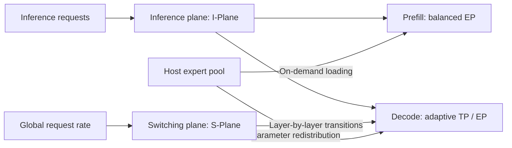

# Dynamo-MoE

**Accelerating Sparse Large Model Inference with Dynamic Parallelization**

Dynamo-MoE improves inference for sparse Mixture-of-Experts (MoE) models by adapting expert workload placement and parallelization to changing demand. It addresses load imbalance while preserving the model's routing decisions, with the goal of improving both latency and throughput.

The paper appeared at **HPDC 2026** and was authored by Jiahao Chen, Shigang Li, Rongtian Fu, Tong Wu, Zhi Ma, and Jingkun Dong.

[Read the paper](https://doi.org/10.1145/3806645.3807820)

## Motivation

MoE models activate only a small subset of experts for each token, increasing model capacity without proportionally increasing computation. However, sparse routing makes expert workloads dependent on the input. Even when experts are evenly distributed across devices, popular experts can overload a few devices while others wait for computation and communication to finish.

Inference also presents different demands across its two phases. Prefill processes many input tokens at once and benefits from balanced computation. Decode generates new tokens for active requests at each step: small batches favor low latency, while larger batches place greater emphasis on throughput. A fixed expert placement and parallelization strategy cannot accommodate all of these conditions equally well.

## Overview

Dynamo-MoE addresses these challenges through two complementary mechanisms: token-level load balancing during prefill and adaptive parallelization during decode.

| Scenario | Challenge | Approach |
| --- | --- | --- |
| Prefill | Skewed expert activation creates uneven device workloads | Token-level workload allocation and on-demand expert loading |
| Decode with small batches | Communication and synchronization increase per-step latency | Tensor parallelism (TP) |
| Decode with large batches | Sustained demand makes throughput increasingly important | Expert parallelism (EP) |
| Changing demand | Fixed parallelization cannot adapt to request intensity | Policy selection with hysteresis and layer-by-layer transitions |

### Prefill: Token-Level Load Balancing

Dynamo-MoE gathers routing information across devices, counts the token assignments received by each expert, and determines a workload quota for each device.

The allocation favors work for locally resident experts, starting with experts that receive fewer tokens. Work that exceeds a device's quota is assigned to devices with available capacity. This allows multiple devices to share a popular expert's workload instead of binding all of its computation to a single device.

When a device needs an expert that is not locally resident, the corresponding weights are loaded from host memory on demand. Resident experts are computed first, allowing weight transfers for missing experts to overlap with available computation. Redistribution changes where an assignment is executed while preserving its selected expert and routing weight.

The resulting allocation also determines token destinations and communication volumes. Variable-sized All-to-All communication coordinates token dispatch and result collection with workload balancing, reducing delays caused by overloaded devices.

### Decode: Adaptive Parallelization

Tensor parallelism partitions each expert's parameters across devices and favors low-latency inference with small batches. Expert parallelism distributes different experts across devices and favors throughput with larger batches.

Dynamo-MoE selects between these strategies using the global request rate. A saturating counter introduces hysteresis: sustained high demand moves the system toward EP, while sustained low demand moves it toward TP. This reduces unnecessary transitions caused by brief workload fluctuations.

Transitions proceed layer by layer. A layer adopts its new parallelization strategy only after the required weights are ready, so different layers may temporarily use different strategies. Weight transfers, buffer role exchanges, and inference computation are coordinated to reduce stalls during parameter redistribution.

## Inference and Switching Planes

The paper organizes the system into an inference plane (I-Plane) and a switching plane (S-Plane). The inference plane executes requests and balances prefill workloads. The switching plane monitors demand and coordinates layer-by-layer changes to decode parallelization.



These optimizations focus on MoE expert computation. They are orthogonal to attention parallelization and KV cache transfer between prefill and decode, and can complement architectures that separate the two inference phases.

## Results

Across the models, hardware, and workloads evaluated in the paper, Dynamo-MoE reports up to **6.75× speedup in time to first token, 1.59× speedup in time per output token, and 1.5× throughput** compared with vLLM baselines with or without expert parallel load balancing (EPLB). The maximum gains for each metric correspond to the experimental conditions reported in the paper.

The central contribution is to connect observed token workloads, expert computation placement, and parallelization policy, while coordinating communication and computation to reduce the cost of adaptation.

## Citation

```bibtex
@inproceedings{chen2026dynamomoe,
  title     = {Dynamo-MoE: Accelerating Sparse Large Model Inference with Dynamic Parallelization},
  author    = {Chen, Jiahao and Li, Shigang and Fu, Rongtian and Wu, Tong and Ma, Zhi and Dong, Jingkun},
  booktitle = {The 35th International Symposium on High-Performance Parallel and Distributed Computing},
  year      = {2026},
  doi       = {10.1145/3806645.3807820}
}
```
